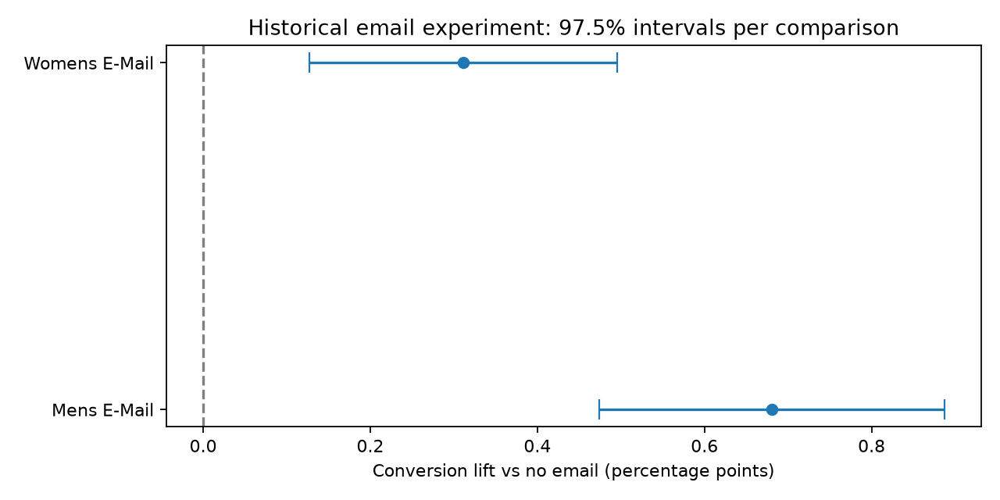

# Historical email experiment results

Retrospective case study. All assigned customers are included.

Source rows: 64,000. SQL/Python counts and revenue reconcile.
Allocation check p-value: 0.903693. Investigation required: False.

## Campaign comparisons

Two planned comparisons with Bonferroni correction. Intervals below are 97.5% each.

### Mens E-Mail vs No E-Mail

- Assigned users: 21,307 vs 21,306.
- Conversion: 1.25% vs 0.57%.
- Absolute lift: 0.681 percentage points (CI 0.474 to 0.887).
- Relative lift: 118.84%.
- Adjusted p-value: 3.04645e-13.
- Revenue difference per assigned customer: 0.7698 (CI 0.4443 to 1.0954, source currency units).
- Positive conversion evidence. Human review required; this is not a profitability or launch decision.

### Womens E-Mail vs No E-Mail

- Assigned users: 21,387 vs 21,306.
- Conversion: 0.88% vs 0.57%.
- Absolute lift: 0.311 percentage points (CI 0.127 to 0.495).
- Relative lift: 54.33%.
- Adjusted p-value: 0.00031421.
- Revenue difference per assigned customer: 0.4244 (CI 0.1323 to 0.7166, source currency units).
- Positive conversion evidence. Human review required; this is not a profitability or launch decision.

## Limitations

- Historical 2008 experiment; no current-market performance claim.
- No original customer IDs or assignment logs; contamination cannot be checked.
- No campaign costs, margins, cancellations, delivery or unsubscribe data.
- Repeated rows may represent different customers and are retained.
- Normal/t intervals are approximations; revenue is skewed.
- Segment analysis is exploratory and must not be used as validated targeting evidence.
- The two campaigns have not been directly tested against each other.

